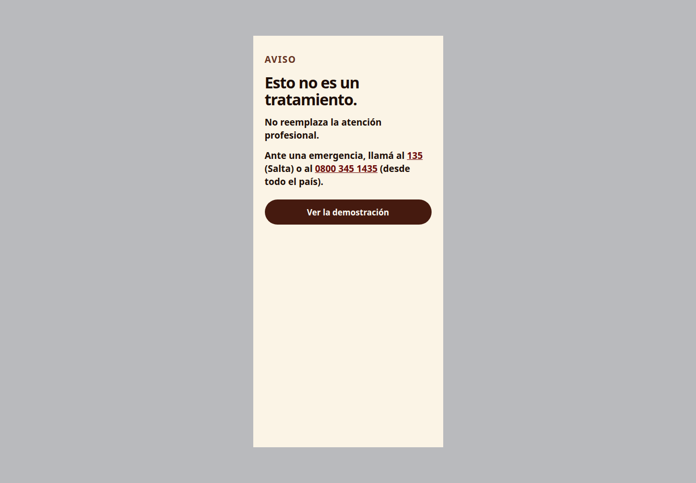
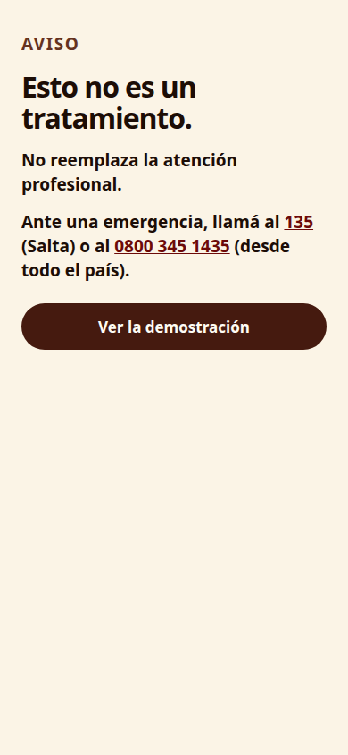
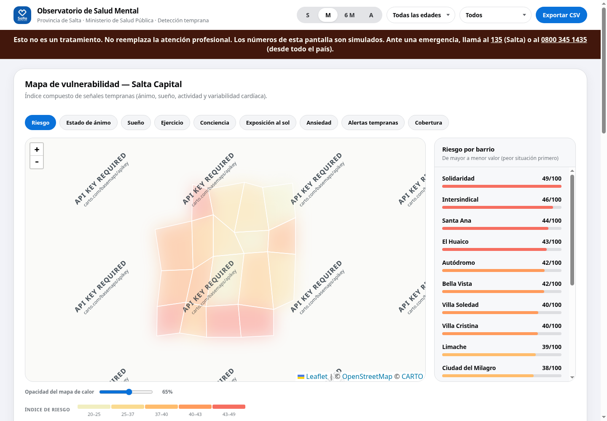

# Anima

Anima es una demostración de un registro emocional voluntario, enlazada con una recreación de WhatsApp y con un tablero institucional de la Provincia de Salta. Sirve para mostrar el recorrido y conversar sobre un piloto. No es un sistema municipal en producción, no guarda datos de una población real y no atiende personas.

## Aviso clínico

**Esto no es un tratamiento.** No reemplaza la atención profesional. Ante una emergencia, llamá al **135** (Salta) o al **0800 345 1435** (desde todo el país).

Si clonás este repositorio y lo publicás para una comunidad, estás publicando una demostración. Quien la abra tiene que poder leer ese límite sin buscarlo: está en esta página, en la primera pantalla de la app y en el tablero.

## Qué hay en el repositorio

| Carpeta | Qué es |
|---|---|
| `frontent-2/` | La app de registro emocional (`index.html`) y el observatorio (`dashboard.html`). El nombre de la carpeta está escrito así en el repositorio. |
| `frontend-3-whatsapp/` | Recreación visual de una conversación de WhatsApp. No es un bot conectado a WhatsApp. |
| `frontent-2-extention/` | Pantalla de consentimiento para compartir datos con el municipio. |
| `presentacion-jueves/` | Propuesta del piloto en LaTeX. |
| `docs/plans/` | Planes de trabajo. No son el producto. |

La app, el chat y el mapa usan datos de demostración. El mapa de barrios es esquemático: no usa límites administrativos oficiales.

## Capturas

La primera pantalla de la app dice el límite antes de mostrar el registro.





El tablero repite el mismo aviso debajo de la barra, en todas las vistas.



## Cómo verlo

Hace falta Git y Python 3. No hay `package.json`, no hay Supabase y no hay un comando `npm run dev`: este repositorio no es una aplicación de ese stack.

```bash
git clone https://github.com/pjcdz/noainnova.git
cd noainnova
python3 -m http.server 8000
```

Abrí [http://localhost:8000/frontent-2/index.html](http://localhost:8000/frontent-2/index.html).

Otras entradas, con el mismo servidor:

- Recorrido de la demostración, con las flechas del teclado: [http://localhost:8000/frontent-2/grupo-9.html](http://localhost:8000/frontent-2/grupo-9.html)
- Tablero institucional: [http://localhost:8000/frontent-2/dashboard.html](http://localhost:8000/frontent-2/dashboard.html)
- Conversación de WhatsApp: [http://localhost:8000/frontend-3-whatsapp/index.html](http://localhost:8000/frontend-3-whatsapp/index.html)

Conviene usar el servidor y no abrir los archivos con `file://`. Varias pantallas se cargan entre carpetas y el navegador bloquea eso como archivo local.

La propuesta en PDF se arma desde `presentacion-jueves/` con el `build.sh` de esa carpeta, si tenés LaTeX instalado. No hace falta para ver la app.

## Stack

HTML, CSS y JavaScript en el navegador. El tablero dibuja el mapa con [Leaflet](https://leafletjs.com/) desde un CDN. La propuesta del piloto está en LaTeX. No hay base de datos, ni backend, ni cuenta de usuarios.

## Licencia

Este repositorio todavía no tiene un archivo `LICENSE`. Hasta que el equipo publique uno, no hay una licencia de código abierto que autorice a copiarlo, modificarlo o desplegarlo. El aviso clínico no reemplaza esa decisión.

## Equipo

Quien escribió en este repositorio, según el historial de Git:

- Pablo Cardozo
- Agustín Emilio Pedernera
- Martín Exeni

## Contribuir

El camino está en [CONTRIBUTING.md](CONTRIBUTING.md). La comunidad se rige por el [código de conducta](CODE_OF_CONDUCT.md).
